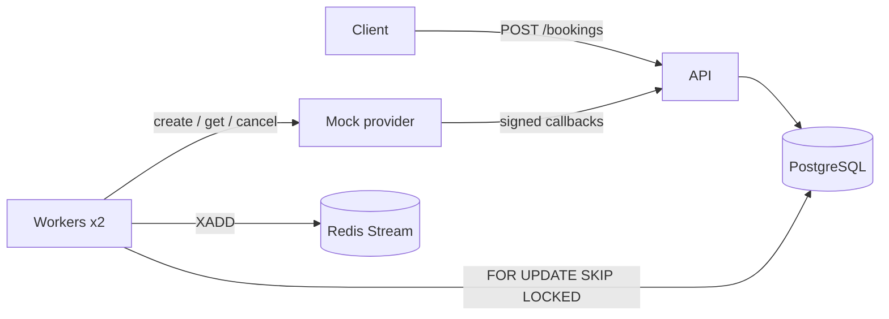
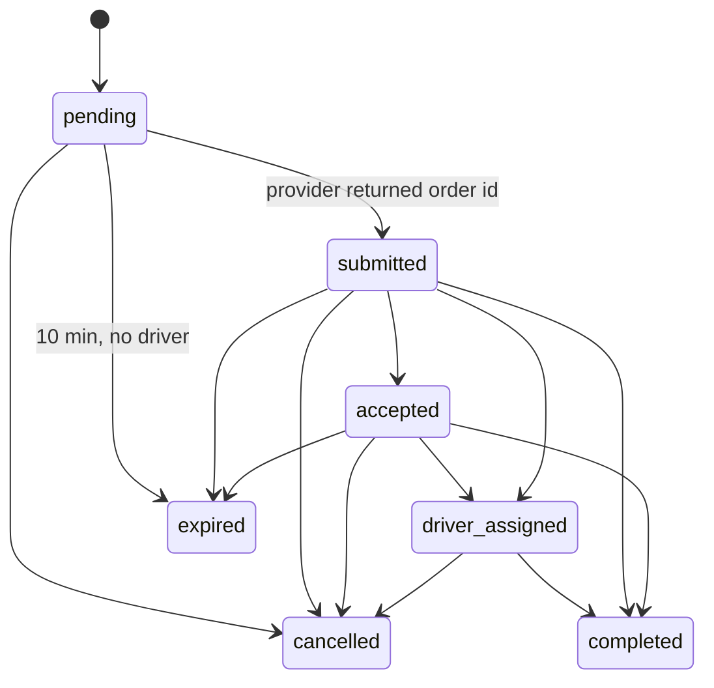

# Ride booking service

A booking service that forwards rides to an unreliable external provider, tracks them
through the provider's callbacks, and charges the client when the ride is completed.

Stack: Python 3.12, FastAPI, SQLAlchemy 2 (async) + Alembic, PostgreSQL, Redis Streams.

## Running it

```bash
docker compose up --build
```

This starts Postgres, Redis, the mock provider (`:8001`), the API (`:8000`) and two worker
replicas. A one-off `migrate` container applies the Alembic migrations first.

```bash
curl -s -X POST localhost:8000/bookings \
  -H 'Content-Type: application/json' -H 'Idempotency-Key: my-key-1' \
  -d '{"client_id":"c1","pickup":"JFK T4","dropoff":"Manhattan","price_amount":6500,"currency":"USD"}'

curl -s localhost:8000/bookings/<id>                             # booking + status history
docker compose exec redis redis-cli XRANGE booking-events - +   # published events
```

Swagger UI is at http://localhost:8000/docs. Postgres and Redis are published on 5433 and 6380
so they don't clash with local installations (override with `POSTGRES_PORT`, `REDIS_PORT`,
`API_PORT`, `PROVIDER_PORT`).

**Tests** run against a real Postgres, because what they check (unique constraints, row locks,
`SKIP LOCKED`) is database behaviour:

```bash
docker compose run --rm tests
```

### Project structure

```
booking_service/src/
  api/            routers, schemas, dependencies
  domain/         models, exceptions, state_machine.py
  repositories/   queries only, never commit
  services/       business logic, each service owns its transaction
  clients/        provider HTTP client, Redis Streams publisher
  workers/        background jobs
  core/           settings, DB engine, HMAC signing
booking_service/migrations/   Alembic
mock_provider/main.py
```

---

## Design notes

### 1. Architecture and state machine



The API never calls the provider: `POST /bookings` stores a `pending` booking and returns. Four
background jobs do the rest:

- **submission**: sends pending bookings to the provider, retries with backoff;
- **outbox relay**: publishes events from the `outbox` table to Redis;
- **expiration**: expires bookings without a driver after 10 minutes and cancels the provider order;
- **reconciliation**: asks the provider about bookings with no update for 2 minutes.

Every status change goes through `BookingStatusService.change_status()` with the booking row
locked, so callbacks and jobs can't overwrite each other.



Forward jumps are allowed because callbacks can be lost. An incoming status is either
**applied**, a **duplicate** (already in that status), **stale** (we've already moved past it,
e.g. `accepted` after `driver_assigned`) or **rejected** with 409 (e.g. `cancelled` after
`completed`). Duplicates and stale updates return 200.

A callback can arrive before we have stored the `provider_order_id`. Every callback is first
saved to the `provider_callbacks` table; if no booking matches yet it stays unprocessed, and the
submission job applies it right after saving the order id.

### 2. Failure analysis

| Crash point | Result | Recovery |
|---|---|---|
| Before the booking insert commits | Nothing stored | Client retries with the same key |
| After commit, before the response | Booking exists, client didn't see it | Retry with the same key returns it |
| Submission worker took a booking, then died | Nothing sent, or order created on the provider | Its 30 s lease runs out, another worker retries with the same `Idempotency-Key` and gets the same order |
| Provider timed out after creating the order | We don't have the id, callbacks may arrive | Retry returns the existing order; early callbacks wait in `provider_callbacks` |
| During callback handling | Transaction rolls back | A real provider would redeliver; with the mock, the reconciliation job catches up |
| `completed` transition | Status, history, ledger entries and outbox event are one transaction | All or nothing |
| After commit, before the event is published | Event row stays in `outbox` | Relay publishes it on the next run |
| After publish, before marking it published | Event is published again | Consumers dedupe by `event_id` |
| After expiring, before cancelling on the provider | Booking is expired, provider order still open | Not retried (see section 5) |

### 3. Delivery guarantees

- **Booking creation: effectively-once.** Unique index on `idempotency_key` +
  `INSERT … ON CONFLICT DO NOTHING`; parallel requests all get the same booking.
- **Creating provider orders: at-least-once calls**, but **one order per booking**, because the
  provider deduplicates on our booking id. Cancelling an order is at-most-once: it's tried once
  after expiration.
- **Callbacks: at-least-once in, effectively-once effect.** Unique `event_id`, a state machine that
  never moves backwards, and a row lock per booking.
- **Ledger: exactly-once.** Written in the same transaction as `completed`, protected by
  `UNIQUE (booking_id, direction)` on `ledger_entries` (one debit and one credit per booking).
- **Events: at-least-once, never phantom.** Transactional outbox; consumers dedupe by `event_id`.

### 4. At 100× load and in 40 countries

- API and workers are stateless and scale horizontally; Postgres is the bottleneck. I would move
  provider calls to a partitioned queue (Kafka keyed by booking id), replace outbox polling with
  CDC, partition history/outbox tables by time, and move the ledger into its own service.
- For 40 countries: regional deployments with their own databases (latency, data residency),
  a provider adapter per country with its own timeouts, rate limits and circuit breaker, and
  per-market config for rules like the 10-minute expiry. Idempotency keys scoped per client
  with a TTL.

### 5. What I skipped or simplified

- No auth.
- Idempotency keys are global and never expire.
- The provider is assumed to deduplicate create requests by our idempotency key.
- The provider order is cancelled once after expiration; if that call fails it is only logged.
- An order created after its booking already expired is not cancelled either.
- The mock provider keeps its state in memory.
- The client sends the price in the request; there is no quote.
- Callback signatures have no timestamp, so there is no replay protection.
- A `completed` callback for an already expired booking is rejected with 409 and logged, not
  resolved.
